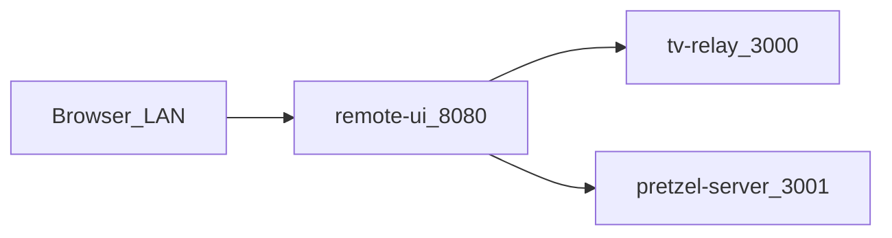

# Pretzel

Node services and scripts that run on the **Pretzel** Pi: LG TV relay, Pi speaker API (TTS, volume, weather, LIFX proxy, WiZ bulbs, Tuya switches, Sonos via Wyat), and a LAN guest UI (**Vite + React**, built to `remote-ui/dist/`) that proxies to them.

## Components

| Area | Path | Role | Default port | Systemd example |
|------|------|------|--------------|-----------------|
| Pi speaker / TTS / volume / weather / LIFX proxy / WiZ bulbs / Tuya switches / Sonos | [pretzel-server/](pretzel-server/) | Express (`/pretzel/*` incl. **`/pretzel/wiz/*`**, **`/pretzel/tuya/*`**, **`/pretzel/sonos/*`**, `/lifx/*`, operator **`/pretzel/admin/*`** on **3001**) | **3001** | [pretzel-server/pretzel-server.service.example](pretzel-server/pretzel-server.service.example) |
| LG TV relay (HTTP + WebSocket to TV) | [tv-relay/](tv-relay/) | Express + `ws`; `GET /tv/status` adds `screenOn` via LG `getPowerState` when the main socket is up (standby can leave the socket open) | **3000** | [tv-relay/tv-relay.service.example](tv-relay/tv-relay.service.example) |
| Guest LAN UI + reverse proxy | [remote-ui/](remote-ui/) | Vite + React → `dist/`; `/` home, **`/settings`** operator page, **`/chess`** two-player chess, **`/tetris`** two-player versus Tetris; `/tv` → 3000, `/pretzel` and `/lifx` → 3001; **PWA** (manifest + service worker after `npm run build`) | **8080** | [remote-ui/remote-ui.service.example](remote-ui/remote-ui.service.example) |
| Shell helpers | [scripts/](scripts/) | `speak.sh TEXT [INSTRUCTIONS]` → OpenAI speech; no instructions uses **tts-1**, non-empty instructions use **gpt-4o-mini-tts** (see `SPEAK_SCRIPT` in pretzel-server) | — | — |

Ports for pretzel-server and tv-relay are set in their `index.js` files unless you add env-based configuration later.

**LIFX (optional):** Set `LIFX_API_TOKEN` on the Pi for `/lifx/*` on pretzel-server (**3001**). Optional `LIFX_API_URL` defaults to `https://api.lifx.com/v1`. Guests on **8080** use the same-origin path `/lifx/*` (proxied to **3001** by `remote-ui`).

**WiZ (Philips WiZ bulbs, optional):** pretzel-server talks to WiZ bulbs directly on the LAN (JSON over UDP **38899**; no cloud or token). Each bulb needs **Allow local communication** on in the WiZ app (Settings → Security) and a fixed IP (DHCP reservation on the router). List bulbs in **`WIZ_LIGHTS`** as comma-separated `ip:label:room`, where room is `Lounge` or `Bedroom` (default `192.168.1.182:Onion:Lounge`; empty disables WiZ). `GET /pretzel/wiz/lights` returns them in the LIFX light shape, so they appear in the same lights panels; `PUT /pretzel/wiz/lights/:ip/state` takes the same body as LIFX (`power`, `brightness`, `color`; `duration` is ignored, since WiZ fades are set in the app). Only IPs in `WIZ_LIGHTS` can be controlled. An unreachable bulb (e.g. wall switch off) shows as **Offline**. They are also labelled in the `/settings` network-device list. Quick check from the Pi: `echo '{"method":"getPilot","params":{}}' | nc -u -w 2 192.168.1.182 38899`.

**Tuya smart switches (optional):** pretzel-server controls Tuya (Smart Life) switches and plugs over the LAN when it can, and through the Tuya Cloud Open API otherwise. List switches in **`TUYA_SWITCHES`** as comma-separated `deviceId:label:room[:ip]` (room is `Lounge` or `Bedroom`; the IP is used for local control and labels the `/settings` device list; empty or unset disables Tuya). `GET /pretzel/tuya/switches` returns them in the LIFX light shape with `has_brightness: false`, so they show in the room's lights panel as an on/off card with no fader; `PUT /pretzel/tuya/switches/:id/state` takes `{"power":"on"|"off"}`. Only device ids in `TUYA_SWITCHES` can be controlled. A switch that answers neither way shows as **Offline** (the reason is logged by pretzel-server).

- **Local (LAN):** done by [tinytuya](https://github.com/jasonacox/tinytuya), which handles every Tuya protocol version including 3.5. One-time setup on the Pi, while the Tuya IoT Core subscription is active (the wizard fetches each device's local key from the cloud; after that the cloud is not needed): `mkdir -p ~/tuya && cd ~/tuya && python3 -m venv venv && venv/bin/pip install tinytuya && venv/bin/python -m tinytuya wizard` (API key/secret from the cloud project, region e.g. `us`, answer **Y** to the DP-name mappings and to polling). pretzel-server runs `pretzel-server/scripts/tuya_local.py` with that Python and reads `~/tuya/devices.json` (override with **`TUYA_LOCAL_DEVICES`** and **`TUYA_LOCAL_PYTHON`**). `devices.json` holds the local keys: keep it out of git. Give each switch a fixed IP (DHCP reservation). **Adding a switch:** pair it in Smart Life, reserve its IP, re-run the wizard (it rewrites `devices.json` with every device on the account), add it to `TUYA_SWITCHES`, restart pretzel-server. Re-pairing a switch changes its key, so re-run the wizard after that too.
- **Cloud (fallback):** **`TUYA_CLIENT_ID`**, **`TUYA_CLIENT_SECRET`** and optional **`TUYA_API_BASE`** (default `https://openapi.tuyaus.com`), the same Tuya IoT project credentials wyat-ai uses. Used for switches not in `devices.json`, or when the LAN call fails. Needs an active IoT Core subscription.

**Sonos (via Wyat):** the **Sonos** panel on the Bedroom tab plays, pauses and sets the volume of each Sonos group, and shows what is playing. pretzel-server does not talk to Sonos itself: the Sonos Control API needs OAuth with a public callback and rotating refresh tokens, and the Wyat backend already holds and refreshes them (it also drives Sonos from routines and MCP). So `/pretzel/sonos/*` calls Wyat's `/sonos/*` routes at **`WYAT_API_URL`** (default `https://api.wyat.ai`), server side. Wyat lets the request in as a Home guest because the Pi's traffic leaves from the home public IP, which must be in **`HOME_PUBLIC_IP`** on Wyat; no key is stored on the Pi. Routes: `GET /pretzel/sonos/groups` (all groups in all households), `GET /pretzel/sonos/groups/:id` (play state, track, artist, source, volume in one call), `POST /pretzel/sonos/groups/:id/play`, `…/pause`, and `…/volume` with `{ "volume": 0–100 }`; for the routine editor, `GET /pretzel/sonos/players` (with `audioClip`: whether the speaker can play spoken clips) and `GET /pretzel/sonos/favorites`. A 401 saying the Pi was refused means the home IP is not in `HOME_PUBLIC_IP`; "No Sonos tokens" means Sonos is not linked in Wyat (Settings → Home there). Sonos on the Pi needs the internet and Wyat to be up.

**Routines:** pretzel-server runs the household's daily lights and spoken reminders itself (no cloud scheduler). Each routine has an **anchor** (a time like `09:00`, or `sunset`/`sunrise` ± minutes), weekdays, and **steps** at minute offsets from the anchor. A step either changes **lights** (`targets`: `all`, `room:Bedroom`, or `light:<LIFX id or WiZ IP>`; `power`, `brightness` 0–1, `kelvin`, `fadeS`, and `onlyIfOff` to leave lights that are already on alone) or **speaks** text (fill-ins `{{time}}`, `{{date}}`, `{{sunrise}}`, `{{sunset}}`, `{{chores}}`, and with a weather fetch `{{tempC}}`, `{{condition}}`, `{{rainNote}}`, `{{sunClause}}`) on the Pi speaker **and** Sonos (by default every Sonos speaker that supports audio clips; or chosen speakers, or Pi only; optional Sonos volume), or plays **Sonos music** (a Sonos Favorite on one speaker, e.g. a Spotify playlist added with *Add to My Sonos*, at a start volume, optionally changing to another volume over some minutes). Speech is rendered once: `speak.sh` saves an MP3 (`SPEAK_OUT`), the Pi plays it, and Sonos speakers fetch it from `GET /pretzel/clips/:name` on the Pi's LAN address (**`PRETZEL_LAN_URL`**, default the Pi's first private IPv4 on 3001); Sonos lowers any music, plays it, and resumes. A speak step fails only if no speaker played it. Sonos goes through Wyat (`POST /sonos/players/:id/favorites` and `…/audio-clip` there), so it needs the internet and Wyat; lights and the Pi speaker don't depend on it. Without `power`, a lights step only changes lights that are on. LIFX fades natively; WiZ fades are stepped from the Pi. Days run in **cycles from 04:00 to 04:00**, so a 00:00 or 01:00 routine belongs to the evening before (Sunday's cycle ends with Monday 01:00). Sunrise and sunset are computed on the Pi for `LAT`/`LON` in `lib/weather.js`, so Sunset's time is known in advance and doesn't need the internet. The defaults (in `lib/routines.js`) are **Wake Up** 09:00 (Bedroom on, 50%, 4000K), **Noon** 12:00 and **Afternoon** 15:00 (spoken reminders), **Sunset** sunset − 60 min (Lounge to 100%, 4000K, only if off), **Wind Down** 00:00 (all lights that are on to 10%, 2200K over 10 min) and **Sleep** 01:00 (all off). The scheduler checks every 30 s; each step is written to the run log before it runs, so a restart never repeats it, and a step missed by up to 5 minutes still runs. Saving a routine or a one-off change never fires steps that were already due. Routes on **3001** (and via 8080): `GET /pretzel/routines`, `GET /pretzel/routines/upcoming` (current and next cycle with resolved times, where each time came from, and run results), `GET /pretzel/routines/lights-next` (each light's next scheduled change, keyed by light id), `GET /pretzel/routines/runs`, `POST /pretzel/routines/:id/run` (run every step now), `PUT|DELETE /pretzel/routines/:id/override/:cycleDate` with `{ "skip": true }` or `{ "time": "07:30" }` (one cycle only, up to 7 ahead), and `PUT|DELETE /pretzel/routines/:id` (create/replace or delete; needs the settings passcode). Saved routines, one-off changes and the run log are `data/routines.json`, `data/routine-overrides.json` and `data/routine-runs.json` (gitignored). **In the UI:** the **Pretzel** tab opens with a **Routines** panel showing today's and tomorrow's full cycle (time, where it came from such as `sunset 18:22 − 60 min`, and Done / Failed / Skipped / Moved, with a countdown on the next one). Tap a routine to see its steps and to **Skip once**, **Move once** (e.g. an earlier wake-up tomorrow), undo either, or **Run now**. Each light card shows its next scheduled change (e.g. `⏱ 17:22 tomorrow · Sunset · on 100% 4000K if off`), skipping steps that won't touch the light as it is now. After unlocking **`/settings`**, the **Routines** editor changes names, times (clock or around sunrise/sunset), days, lights steps (rooms, power, level, colour temperature, fade, only-if-off) and speak steps (text and voice), and adds or deletes routines. Sunrise and sunset are rounded to the minute, so the time shown is the time it runs. The old fixed reminders (`/pretzel/reminders`, `data/reminders.json`) are gone; the chores "every reminder" count now counts routine speech.

**TV power:** the **POWER** key in the LG TV panel calls `POST /tv/power/on` on tv-relay, which needs **`TV_WOL_MAC`** (the TV's MAC) to wake it from full off via Wake-on-LAN; from standby it also works over the open WebSocket. If neither is possible the panel shows the relay's error. Turning off needs a second tap to confirm.

## Operator settings (remote UI)

Operator UI is at **`/settings`** on **8080** (e.g. `http://pretzel.local:8080/settings`). After passcode unlock it runs **git pull** in `PRETZEL_REPO_ROOT`, restarts **pretzel-server** / **tv-relay** / **remote-ui**, rebuilds **remote-ui**, and shows **systemd** last start times (`ActiveEnterTimestamp`). All of that goes to pretzel-server over **`/pretzel/admin/*`** with header **`X-Pretzel-Settings-Passcode`** (must match **`PRETZEL_SETTINGS_PASSCODE`** on the Pi). There is **no default**: until that env var is set, `/pretzel/admin/*` and routine edits answer **503**. The passcode is not in the UI bundle; you type it on `/settings`, the Pi checks it, and the tab keeps it for the session.

- **`PRETZEL_REPO_ROOT`:** directory passed to `git -C` (default: parent of `pretzel-server`, i.e. the monorepo root on disk).
- **Restart pretzel-server:** the HTTP response returns first; the browser connection then drops when the service restarts. Reload the page to refresh “last restarted” for that unit.
- **Restart remote-ui:** same as pretzel-server — remote-ui carries the request, so the response returns first and the page then waits for a new start time and offers **Reload page**.
- **Rebuild remote-ui:** runs in the background on pretzel-server (in `$PRETZEL_REPO_ROOT/remote-ui`): `npm ci` (only when `package-lock.json` is newer than the last install), `tsc --noEmit`, `vite build` into `dist-next/`, swaps it into `dist/`, then restarts remote-ui. A failed build leaves the old `dist/` serving and shows the log tail on the page. Typical flow after a UI change: **Git pull** → **Rebuild remote-ui**. The pretzel-server user needs write access to `remote-ui/` (normally it owns the checkout). Progress: `GET /pretzel/admin/rebuild/remote-ui`.
- **sudo:** the service user needs passwordless **`systemctl restart`** for **`pretzel-server.service`**, **`tv-relay.service`** and **`remote-ui.service`**. If **`systemctl show … ActiveEnterTimestamp`** fails without elevated rights, allow those read-only `show` commands too. Example (replace `william` with your `User=`):

```
william ALL=(root) NOPASSWD: /bin/systemctl restart pretzel-server.service, /bin/systemctl restart tv-relay.service, /bin/systemctl restart remote-ui.service, /bin/systemctl show pretzel-server.service, /bin/systemctl show tv-relay.service, /bin/systemctl show remote-ui.service
```

**First deploy of the rebuild button:** the button lives in the UI it rebuilds, so bootstrap once: add the sudoers line above, tap **Git pull** then **Restart pretzel-server** in the old UI, then trigger the first rebuild by hand:

```bash
curl -sS -X POST -H "X-Pretzel-Settings-Passcode: YOUR_SECRET" http://pretzel.local:8080/pretzel/admin/rebuild/remote-ui
```

Example status check:

```bash
curl -sS -H "X-Pretzel-Settings-Passcode: YOUR_SECRET" http://127.0.0.1:3001/pretzel/admin/status
```

## Chess (`/chess`), Tetris (`/tetris`) and network devices

- **Chess:** open `http://pretzel.local:8080/chess` on two phones. Like Tetris it is a full-screen game with no navbar; it opens on a menu (**Play** → character and name, then **Play White** / **Play Black** / **Watch** as seats allow; **Past games**; **Exit**). The top bar keeps the Moog look of every game: the game name, a connection LED with an amber readout, and **✕** to quit. Below it the table sits on a pixel-art parchment scroll (sprites in `remote-ui/public/sprites/scroll/`, drawn as ASCII art and generated by `scripts/chess-scroll.py`): the opponent's portrait and name (UnifrakturMaguntia, drawn pixelated) above the board and yours below, each with an hourglass clock in bitmap digits, the pieces that player has captured (+N when ahead on material) and a status line with a gem: emerald = that player's move ("Your turn", "Thinking…"), topaz = check or a draw offer, ruby = offline (their clock still runs), iron = waiting or finished ("Waiting on you", "Won by checkmate", "Checkmated"). Moves run along the walnut bar at the bottom; before the first move that bar picks the clock (∞ / 5 / 10 / 15|10). The **Menu** plank on the scroll's bottom roller has draw offers, resign, rematch, leave seat, flip board and past games; every chess dialog is a small scroll with bevelled pixel buttons. Leaving the page keeps your seat (per-browser id), so come back on the same phone. pretzel-server is the referee (rules via `chess.js`: check, checkmate, castling, en passant, promotion, stalemate, insufficient material, threefold, 50-move; a flag fall against a lone king is a draw). Before the first move an offline player's seat can be taken, after a game ends anyone can start the next one, and a game both players left for 10 minutes can be cleared (saved as abandoned); Pi downtime is not charged to the clocks. WebSocket at `/pretzel/chess/ws`. The live game is in `pretzel-server/data/chess-state.json`; finished games (SAN moves with timestamps, PGN, result, players; last 200) go to `chess-games.json` (both gitignored), served by `GET /pretzel/chess/games[/:id]`. Portraits react to the last move (`remote-ui/src/lib/chessAvatars.ts`): the side to move looks thoughtful; a check, a capture of anything but a pawn, or a promotion makes the mover smug and the other side shocked until the next move; the game ends on victorious / loss. The two players can't share a character. Every move by either side plays one of three piece clicks (`remote-ui/public/audio/chess-move-*.mp3`, Web Audio, unlocked by the first tap). Each character is a 6-frame 48×48 strip in `remote-ui/public/avatars/chess/` (box-resampled down from the art's native 62-cell grid for a chunkier look, shown at 64px), rebuilt from the source art with `scripts/chess-avatars.py` (Pillow + NumPy). Piece sprites: Cburnett set (CC BY-SA 3.0) in `remote-ui/public/sprites/chess-pieces.svg`; fonts: UnifrakturMaguntia (SIL OFL) for names, Pixelta (Blankids Studio) for status lines, menus, dialogs and the board coordinates. **Pixelta is not in git** (this repo is public, and it stays gitignored until the font is licensed for redistribution): copy `Pixelta.ttf` to `remote-ui/public/fonts/` on the Pi before rebuilding remote-ui, e.g. `scp Pixelta.ttf pi@pretzel.local:~/pretzel/remote-ui/public/fonts/`; without it those labels fall back to Outfit.
- **Tetris:** open `http://pretzel.local:8080/tetris` on two phones (or two tabs: the player id is per tab). It opens as a full-screen game with no navbar and no scrolling; **✕** exits (mid-match it asks first, since leaving forfeits). Joining, waiting, results and **How to play** (**?**) are overlays; the first two to **Join** play, anyone else can **Watch** both boards. Each phone runs its own game from a shared seed sent by pretzel-server, so both get the same 7-bag piece order; the Pi only seats players, starts a 3 s countdown, relays garbage and board snapshots, and decides the winner (first top-out loses). Your board is on the right with Next, the stats and the opponent's board on the left. Controls are round keys on a walnut panel: a larger **⟳** rotate-clockwise key for the left thumb, and a triangle for the right thumb (**◀ ▶** move, hold to slide; **▼** below them, soft drop, double-tap for a hard drop). Clearing 2 / 3 / 4 lines sends 1 / 2 / 4 garbage rows, and your own clears cancel queued garbage first. Hiding the tab for 3 s or disconnecting for 5 s also concedes. **Play again** starts a new match once both players press it. **Music:** the **♪** key (or **Sound** in the lobby) picks the soundtrack, remembered per phone: **Chiptune (MIDI)**, the default, plays `remote-ui/public/audio/tetris-theme-a.mid` (Game Boy Tetris A-theme, sequenced by NeonMickle/Mickle) through a small Web Audio synth (square lead and harmony, wave bass, noise drums) and speeds up 4% per level (up to 1.56× at level 15); **Recording (MP3)** loops `remote-ui/public/audio/tetris-theme.mp3` at its own tempo; or **Off**. Music starts when the countdown ends and stops when the match does. Clearing 2 or 3 lines plays `line-clear.mp3` and a 4-line Tetris plays `tetris-clear.mp3` (NES line-clear sounds, also in `remote-ui/public/audio/`); a single line is silent, and **Off** mutes these effects as well as the music; on iPhone it plays even with the silent switch on (Safari 16.4+). WebSocket at `/pretzel/tetris/ws`; nothing is saved (a pretzel-server restart drops the current match). Server tests: `cd pretzel-server && npm test`.
- **Network devices:** `/settings` (after unlock) lists devices the Pi can see on its LAN (IP, MAC, hostname, state) via `GET /pretzel/admin/devices[?refresh=1]` (cached 15 s). It uses the default-route interface, sends one UDP datagram to every address in its /24 so the kernel ARPs them (no `ping` processes; finds phones that ignore ping), then reads `ip neigh` (falls back to `/proc/net/arp`). Names come from reverse DNS. The router, this Pi, the LG TV (`TV_IP`, default `192.168.1.186`) and seated chess players are labelled; "(private)" marks randomised phone MACs. It shows LAN neighbours, not Wi‑Fi association, so sleeping devices may be missing.

## Traffic flow

Guests on the same Wi‑Fi open the Pi on port **8080**. The UI talks to **relative** URLs `/tv/*`, `/pretzel/*`, and `/lifx/*`; `remote-ui` forwards TV to **3000** and pretzel-server (speaker + LIFX) to **3001**. Installability as a **PWA** (“Add to Home Screen”) generally needs a **secure context** (HTTPS, or `http://localhost` for local dev); plain `http://` to the Pi may still work in the browser but limits install prompts on some platforms.



## Deploy on the Pi (summary)

1. Clone or pull: `cd ~/pretzel && git pull`
2. Install dependencies where there is a lockfile:
   - `cd ~/pretzel/pretzel-server && npm ci`
   - `cd ~/pretzel/tv-relay && npm ci`
   - `cd ~/pretzel/remote-ui && npm ci && npm run build`  
   (`remote-ui` must be **built** after each pull that changes the UI; `dist/` is gitignored. For local UI work: `cd ~/pretzel/remote-ui && npm run dev` — Vite proxies `/tv`, `/pretzel`, `/lifx` to **3000** / **3001**.)
3. Install systemd units from the `*.service.example` files (copy to `/etc/systemd/system/`, edit `User` and `WorkingDirectory`), then:
   - `sudo systemctl daemon-reload`
   - `sudo systemctl enable --now pretzel-server tv-relay remote-ui`  
   (enable only the units you use; start **pretzel-server** and **tv-relay** before **remote-ui**.)

Longer comments and pairing notes for tv-relay are in [tv-relay/tv-relay.service.example](tv-relay/tv-relay.service.example) and [remote-ui/remote-ui.service.example](remote-ui/remote-ui.service.example).

## Release version (`VERSION` and git tags)

- **Repo version:** The file [VERSION](VERSION) holds a single semver line (e.g. `1.3.7`). This is the stack-wide release identifier agents should bump when committing (see [AGENTS.md](AGENTS.md)).
- **Git tags:** To label a release on GitHub, create an **annotated** tag on the release commit, e.g. `git tag -a v1.3.7 -m "Release 1.3.7"` then `git push origin v1.3.7`. Tags appear under the repo’s “Tags”; you can create a **GitHub Release** from a tag for notes and visibility. Prefer tagging intentional releases, not every commit.

## Systemd: which version is running?

Example unit files include an optional env var (commented) you can enable on the Pi:

```ini
# Environment=PRETZEL_STACK_VERSION=1.7.13
```

Set the value to match [VERSION](VERSION) after each deploy. Inspect what systemd passed to a unit:

```bash
systemctl show remote-ui -p Environment
systemctl show tv-relay -p Environment
systemctl show pretzel-server -p Environment
```

**Git commit on the machine (optional):** You can add another line, e.g. `Environment=PRETZEL_GIT_SHA=abc1234`, filled from `git rev-parse --short HEAD` on the Pi when debugging. GitHub commit URL: `https://github.com/<owner>/<repo>/commit/<full-sha>`.

## Quick health checks (on the Pi)

```bash
curl -sS http://127.0.0.1:3000/tv/status
curl -sS http://127.0.0.1:3001/pretzel/status
curl -sS http://127.0.0.1:8080/tv/status
curl -sS http://127.0.0.1:8080/pretzel/status
curl -sS http://127.0.0.1:8080/lifx/scenes
curl -sS http://127.0.0.1:8080/pretzel/wiz/lights
curl -sS http://127.0.0.1:8080/pretzel/tuya/switches
curl -sS http://127.0.0.1:8080/pretzel/sonos/groups
```

If **8080** refuses connections: confirm `remote-ui` is running (`systemctl status remote-ui`), that you ran `npm run build` in `remote-ui` (so `dist/index.html` exists), and read logs: `journalctl -u remote-ui -n 40 --no-pager`. Foreground check: `sudo systemctl stop remote-ui` first if 8080 is busy, then `cd ~/pretzel/remote-ui && node server.cjs` (Ctrl+C to stop). If your unit still says `server.js`, update **ExecStart** to `node server.cjs` after pull.
